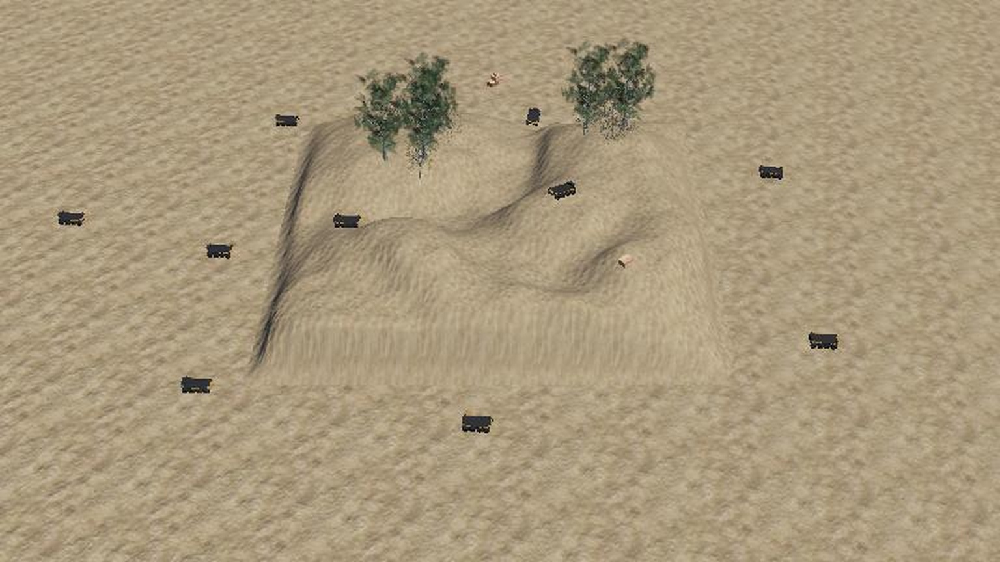
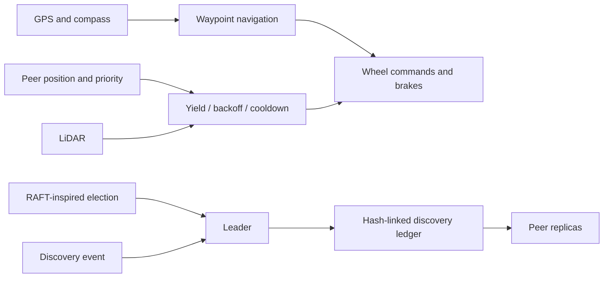
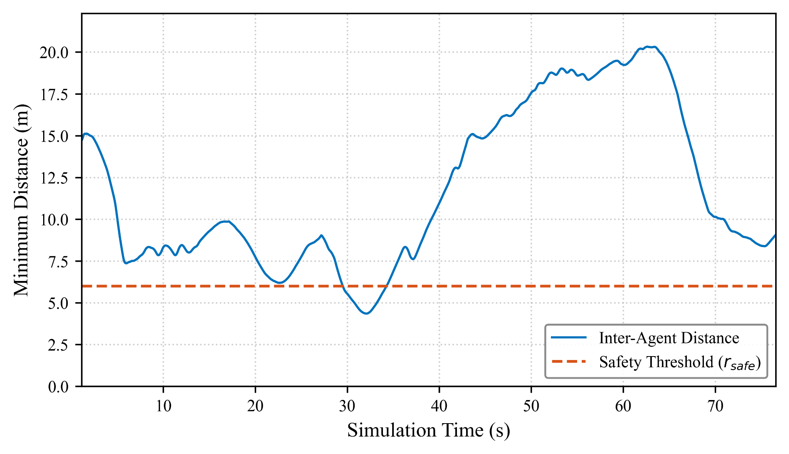
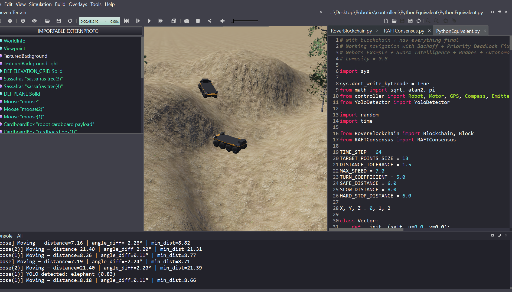

# APIS | Decentralized Planetary Rover Swarms

**RAFT-inspired coordination · distributed discovery ledger · multi-rover navigation**

  



*A historical Webots simulation screenshot, enlarged 2× for presentation (no new scene detail or simulation data generated).*

APIS explores decentralized coordination for planetary-rover teams operating on uneven terrain, motivated by lunar lava-tube exploration. Each rover executes a local navigation controller and exchanges position and election messages with its peers. A RAFT-inspired election mechanism selects a leader, which coordinates replication of a hash-linked discovery ledger.

**Devkarthik Suresh** · Accepted at IEEE INDISCON 2026 and IROS 2026 MAS-BW Workshop (author-reported). See [publication and citation information](docs/PUBLICATION.md).

## Architecture



| Component | Implementation |
| --- | --- |
| Navigation | GPS/compass waypoints and eight-wheel steering commands |
| Collision avoidance | Distance and priority-based yielding, LiDAR-guided sidestep, timed backoff and cooldown |
| Election | Follower/candidate/leader states, randomized priority-biased timeouts, majority voting and heartbeats |
| Discovery | Simulated resource events forwarded to leader; SHA-256-linked ledger replication and resynchronization |
| Environment | Webots R2025a, ten Clearpath Moose rover instances on uneven terrain |

## Paper-reported results

The latest author-supplied INDISCON manuscript (paper 1854, Section V, Table II) is the reference for the reported research results. The recovered CSVs may originate from earlier development runs and are not the underlying dataset for this table unless their provenance can be established.

| Swarm size | Average recovery latency (s), as reported | Successful failovers |
| --- | ---: | ---: |
| 3 | 4.17 ± 0.61 | 5/5 |
| 5 | 3.80 ± 0.55 | 5/5 |
| 10 | 3.42 ± 0.23 | 5/5 |

The manuscript reports **15/15 successful failovers (100%)**, successful ledger synchronization after a rover rejoined, and a global minimum separation of **1.95 m** (Section V-A). These are paper-reported findings, not independently reproduced measurements. The per-trial recovery records and original distance samples are not available in this archive. See [reproducibility notes](docs/REPRODUCIBILITY.md) for the differences between the manuscript, supplied figure and recovered implementation.

## Archived development artifacts

The author indicates that the CSV logs may predate the final paper experiments. They are retained byte-for-byte in `results/archived_development/` for historical reference, not presented as the final experimental dataset.



The supplied figure shows an inter-agent distance trace and a 6 m reference threshold; the trace briefly crosses below the threshold. It is retained as supplied, rather than recreated from unavailable distance samples.

| Evidence | Recorded observation |
| --- | --- |
| Election metrics CSV | Term 1: election started at 3.752 s; leader elected at 3.880 s |
| Election metrics CSV | Term 2: election started at 8.680 s; leader elected at 8.808 s |
| Election start to leader elected | 0.128 s for each recorded pair (not crash recovery time) |
| Paper-reported recovery latency | See Table II summary above; individual trial measurements not included in the recovered archive |



*Historical interface screenshot; the earlier controller shown may differ from the recovered source.*

## Run locally

1. Install [Webots R2025a](https://github.com/cyberbotics/webots/releases/tag/R2025a) and configure its Python interpreter.
2. Place the original customized `Moose.proto` in `protos/` (see [asset instructions](protos/README.md)). The public archive deliberately does not redistribute this separately licensed asset. External Webots assets are referenced by release-specific URLs; internet access or an appropriate asset cache may be needed.
3. Open `worlds/rover.wbt` in Webots. The original saved world has nine enabled controllers and one disabled controller (`moose(8)`). For an all-active baseline, enable its `PythonEquivalent` controller in a copy of the world.
4. Start the simulation. Inspect the controller console, generated election and leader logs, and discovery ledger JSON files. Archive each new run separately.

The core Python code uses the Webots controller API and the standard library; no extra pip packages are required for the standalone tests.

```bash
python -m unittest discover -s tests -v
python scripts/audit_logs.py
```

## Repository layout

```text
controllers/PythonEquivalent/  # Original navigation, election and ledger source
worlds/rover.wbt               # Original saved experiment world
protos/                        # Instructions for local customized Moose asset
assets/                        # Archived screenshots and distance figure
results/paper_reported_recovery.csv # Transcribed manuscript Table II
results/archived_development/   # Original CSVs of uncertain trial provenance
scripts/audit_logs.py           # Non-destructive historical log audit
tests/                         # Standalone component checks
docs/                          # Publication, reproducibility and attribution
CITATION.cff                   # Research software citation metadata
```

## Scope and limitations

This is a research prototype, not a formally safe collision-avoidance system or full Raft consensus implementation. The recovered CSVs are archival development evidence, not a verified dataset for the latest manuscript. The exact experimental revision remains unconfirmed. The Webots simulation has not been rerun during repository packaging; see [reproducibility notes](docs/REPRODUCIBILITY.md) for assumptions and missing evidence.

Webots and Clearpath Moose model assets retain their respective third-party terms. No blanket open-source license has been assigned to the author's code pending the author's choice. See [asset notes](protos/README.md).
